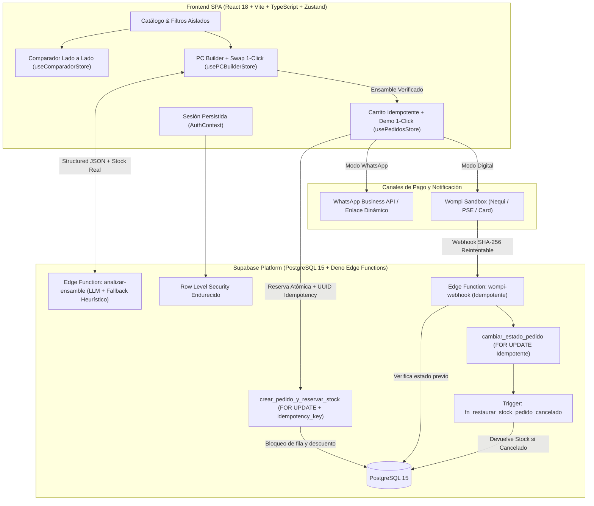

# NEXUS // CORE — High-Performance Hardware Commerce & Architecture Platform (V2.0 Enterprise)

> [🇺🇸 Read documentation in English](./README.md)

> **NEXUS // CORE** es una solución integral de ingeniería de software para comercio electrónico de hardware de cómputo de alta gama. Resuelve de raíz los mayores puntos de fricción en la venta de tecnología en América Latina: la incertidumbre de compatibilidad física/energética, los cuellos de botella CPU/GPU, la concurrencia e idempotencia en reservas de inventario y pagos, y la fricción de conversión entre pasarela digital (Wompi) y WhatsApp.

---

## 📖 ¿Qué es NEXUS // CORE y qué problema resuelve?

En el mercado minorista de tecnología y componentes de computación, el cliente promedio enfrenta barreras significativas:
1. **Miedo a la Incompatibilidad y Cuellos de Botella:** Adquirir un procesador incompatible con la placa madre, memorias DDR5 en boards DDR4, fuentes de poder insuficientes o tarjetas gráficas limitadas por una CPU de gama inferior.
2. **Falta de Claridad Técnica:** Comparar especificaciones complejas (frecuencias, latencias, VRAM, TDP) en pestañas separadas genera fatiga de decisión y abandono del carrito.
3. **Condiciones de Carrera e Idempotencia en Checkout:** Reservar inventario sin bloqueo transaccional provoca sobreventas (*overselling*), mientras que los reintentos de webhook o dobles clics en pagos digitales pueden duplicar cargos o restaurar stock doblemente.
4. **Barreras de Pago Locales:** Forzar pasarelas rígidas reduce la conversión frente a medios locales (Nequi, PSE) y asesoría por WhatsApp.

**NEXUS // CORE (Release V2.0 Enterprise)** combina:
- Un **Armador Interactivo de PC con Asesor IA de Cuellos de Botella (`analizar-ensamble`)** conectado al stock real con reemplazo **Swap 1-Click**.
- Una **Capa Transaccional Concurrente e Idempotente en PostgreSQL (Supabase)** con `FOR UPDATE`, `pg_advisory_xact_lock`, `idempotency_key` y triggers atómicos de reversión de stock.
- Un **Comparador Técnico Lado a Lado** con desambiguación estricta anti-colisiones y motor heurístico ganador.
- Un **Checkout Híbrido con Datos de Prueba 1-Click** compatible con **Wompi Sandbox (Nequi, PSE, Tarjeta)** y **WhatsApp** con webhooks idempotentes.
- Un **Panel de Administración en Vivo** con staging no destructivo de medios, alertas de stock crítico y reposición rápida.

---

## 🏛️ Diagrama de Arquitectura del Sistema



---

## 💎 Módulos del Sistema en Detalle

### 1. 🧠 Asesor IA de Arquitectura & PC Builder Interactivo
Diseñado para eliminar la incertidumbre técnica y optimizar el presupuesto:
- **Flujo Guiado Paso a Paso:** CPU $\rightarrow$ Motherboard $\rightarrow$ Memoria RAM $\rightarrow$ GPU $\rightarrow$ Almacenamiento SSD $\rightarrow$ Refrigeración CPU $\rightarrow$ Gabinete $\rightarrow$ Fuente de Poder (PSU).
- **Motor de Compatibilidad (`usePCBuilderStore`):** Valida socket (`AM5`, `AM4`, `LGA1700`, `LGA1200`), estándar RAM (`DDR4`/`DDR5`), factor de forma (`ATX`, `Micro-ATX`, `Mini-ITX`) y margen energético (+25% + 40W base).
- **Supabase Edge Function `analizar-ensamble`:**
  - Soporta **Structured Outputs (JSON)** mediante LLM (`GEMINI_API_KEY` u `OPENAI_API_KEY`) con verificación estricta contra `public.productos` (`stock > 0`) para prevenir alucinaciones.
  - **Fallback Determinístico (<50 ms):** Si no hay API Key configurada, ejecuta un motor heurístico local que detecta cuellos de botella CPU/GPU, déficit térmico de TDP en disipadores y reserva eléctrica de PSU.
  - **Swap 1-Click:** Muestra hasta 2 upgrades reales disponibles en stock para reemplazar la pieza sugerida en el ensamble con un solo clic.

### 2. 🔒 Idempotencia Transaccional en Reservas y Webhooks (PostgreSQL + Deno)
- **Clave Única de Idempotencia (`idempotency_key uuid UNIQUE`):** Cada intento de checkout en `public.pedidos` viaja con una llave UUID única generada en cliente.
- **Serialización Segura (`pg_advisory_xact_lock` + `FOR UPDATE`):** Si el usuario hace doble clic o reintenta una petición de red con la misma clave, `crear_pedido_y_reservar_stock` retorna el pedido existente de forma idempotente sin volver a descontar stock.
- **Webhooks Tolerantes a Reintentos (`wompi-webhook`):** Deduplica eventos recientes en memoria y verifica en PostgreSQL el estado/referencia del pedido antes de ejecutar `cambiar_estado_pedido`, evitando transiciones duplicadas o doble devolución de stock.

### 3. ⚖️ Comparador Técnico Lado a Lado (Side-by-Side)
- Clasificación granular anti-colisiones (`cpu`, `gpu`, `ram`, `storage`, `board`, `psu`, `case`, `cooler`, `teclado`, `mouse`, `monitor`, `audio`) que evalúa tarjetas madre y disipadores antes que procesadores.
- **Resaltado Heurístico (`obtenerIndicesGanadores`):** Destaca automáticamente el mejor valor en precio, latencia, VRAM, frecuencias, TDP y tasa de refresco.

### 4. 📦 Gestión de Inventario, Experiencia Demo y Administración
- **Autocompletado Demo 1-Click:** Botón **"Rellenar datos de prueba"** en carrito y pasarela Wompi Sandbox para probar el flujo completo (Reserva Atómica $\rightarrow$ Webhook $\rightarrow$ Descuento/Reversión de Stock) en segundos.
- **Control Crítico en `SettingsModal`:** Alertas visuales para stock $\le 3$, reposición rápida (+5/+10 uds), fijación global y descuentos por categoría.
- **Categorización Jerárquica y Staging de Medios (`AdminProductoModal`):** Selector de grupo (`Componentes` vs `Periféricos`) + subcategorías dedicadas y eliminación reversible de imágenes antes de guardar.

---

## 🗄️ Migración SQL y Variables de Entorno

### Aplicar Migración de Idempotencia V2.0 en Supabase
Ejecuta los scripts en orden dentro del **SQL Editor** de Supabase (o usando `supabase db push` con Supabase CLI):
1. `supabase/migrations/20261028010000_orders_and_pc_builder.sql` (si es una base nueva)
2. `supabase/migrations/20261115000000_idempotency_and_ai_advisor.sql` (añade `idempotency_key`, lock de asesoría en reservas e idempotencia en cambio de estado)

### Variables de Entorno
```env
# Frontend (.env)
VITE_SUPABASE_URL=https://tu-proyecto.supabase.co
VITE_SUPABASE_ANON_KEY=tu-anon-key-de-supabase
VITE_WOMPI_PUBLIC_KEY=pub_test_NexusCoreSandboxCol
VITE_WOMPI_INTEGRITY_SECRET=test_integrity_nexuscore_sandbox_secret

# Opcional: Secrets de Supabase Edge Functions
GEMINI_API_KEY=...          # o OPENAI_API_KEY=... para analizar-ensamble con LLM real
WOMPI_EVENTS_SECRET=...     # Validación SHA-256 de eventos entrantes en wompi-webhook
```

### Comandos
```bash
npm install
npm run dev
npm run lint
npm run build
```

---

Desarrollado por el equipo de **NEXUS // CORE** bajo arquitectura full-stack de alto rendimiento sobre **React, TypeScript, Supabase PostgreSQL y Deno Edge Functions**.

