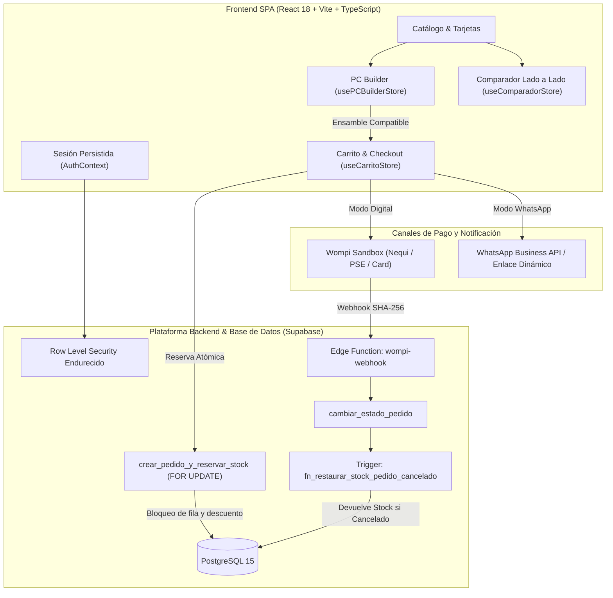

# NEXUS // CORE — High-Performance Hardware Commerce & Architecture Platform

> **NEXUS // CORE** es una solución integral de ingeniería de software para comercio electrónico de hardware de cómputo de alta gama. Resuelve de raíz los tres mayores puntos de fricción en la venta de tecnología en América Latina: el temor del comprador a adquirir piezas incompatibles, los pedidos fantasma que congelan el inventario sin pagarse, y la fricción de pagos digitales frente al canal de mayor conversión en la región: WhatsApp.

---

## 📖 ¿Qué es NEXUS // CORE y qué problema resuelve?

En el mercado minorista de tecnología y componentes de computación, el cliente promedio enfrenta barreras significativas:
1. **Miedo a la Incompatibilidad:** Comprar un procesador con socket incompatible con la placa madre, memorias DDR5 en boards DDR4, o una fuente de poder insuficiente para una GPU moderna.
2. **Falta de Claridad Técnica:** Comparar especificaciones complejas (frecuencias, latencias, VRAM, TDP) en pestañas separadas de navegador genera fatiga de decisión y abandono del carrito.
3. **El Dilema del Checkout:** Si el comercio redirige directamente a WhatsApp, el inventario no se descuenta automáticamente; si se descuenta de inmediato sin pasarela, cualquier usuario puede vaciar el stock de la tienda sin pagar.
4. **Barreras de Pago Locales:** Forzar a un cliente a pasarelas bancarias rígidas reduce la conversión de quienes prefieren contraentrega, transferencias directas por Nequi o asesoría en tiempo real.

**NEXUS // CORE** nace como un ecosistema unificado que combina:
- Un **Armador Interactivo de PC** con verificador algorítmico de compatibilidad física y balance energético en tiempo real.
- Un **Comparador Técnico Lado a Lado** con motor heurístico de selección que resalta automáticamente la ventaja técnica y de costo.
- Una **Capa Transaccional Concurrente en PostgreSQL (Supabase)** que bloquea el stock de forma atómica con reversión automática mediante triggers ante pedidos cancelados.
- Un **Checkout Híbrido** que permite pagar de inmediato con simulación digital de **Wompi Sandbox (Nequi, PSE, Tarjeta)** o generar un pedido formal y coordinar por **WhatsApp**.
- Un **Panel de Administración en Vivo** con control no destructivo de catálogo, galerías de medios y monitoreo de reservas.

---

## 🏛️ Diagrama de Arquitectura del Sistema



---

## 💎 Módulos del Sistema en Detalle

### 1. 🛠️ Armador de PC Interactivo ("PC Builder")
Diseñado para eliminar la incertidumbre del armado:
- **Flujo Guiado Paso a Paso:** CPU $\rightarrow$ Motherboard $\rightarrow$ Memoria RAM $\rightarrow$ GPU $\rightarrow$ Almacenamiento SSD $\rightarrow$ Refrigeración CPU $\rightarrow$ Gabinete $\rightarrow$ Fuente de Poder (PSU).
- **Motor de Compatibilidad en Memoria (`usePCBuilderStore`):**
  - **Socket Matching:** Cruza procesadores y placas madre (`AM5`, `AM4`, `LGA1700`, `LGA1200`).
  - **Memory Generation:** Filtra exclusivamente módulos compatibles (`DDR5` vs `DDR4`).
  - **Form Factor Guard:** Valida que el factor de forma de la tarjeta madre (`ATX`, `Micro-ATX`, `Mini-ITX`) sea soportado por el chasis.
  - **Cooler Bracket Compatibility:** Comprueba compatibilidad declarada de anclaje térmico.
- **Balance y Medidor Energético Dinámico:**
  $$\text{TDP Total Estimado} = \sum \text{TDP de componentes seleccionados}$$
  $$\text{Fuente Recomendada} = \text{MúltiploSuperior50}\left( (\text{TDP Total} + 40\text{W base}) \times 1.25 \right)$$
  Si el usuario selecciona una fuente con potencia nominal inferior al umbral seguro, el sistema emite una advertencia visual bloqueante.

---

### 2. ⚖️ Comparador Técnico Lado a Lado (Side-by-Side)
- Permite seleccionar de 2 a 3 componentes o periféricos del catálogo.
- **Resaltado Inteligente Heurístico (`obtenerIndicesGanadores`):**
  - Evalúa numéricamente cada especificación técnica y destaca en **verde esmeralda** la mejor alternativa:
    - *Menor valor gana:* Precio final, latencia CAS (CL), tiempo de respuesta (ms), consumo energético (TDP) y nivel de ruido (dB).
    - *Mayor valor gana:* Frecuencias base/turbo (GHz/MHz), memoria de video (VRAM GB), núcleos/hilos, capacidad de almacenamiento (GB/TB), tasa de refresco (Hz), DPI y potencia (W).
- Barra de estado flotante no intrusiva y modal responsive con inyección directa al carrito.

---

### 3. 📦 Reserva Concurrente de Stock y Gestión de Pedidos (RPC)
- **Eliminación de Bucles y Sobreventa en Carrito:**
  - Si el usuario añade unidades hasta el tope disponible (`enCarrito + cant >= stock`), el sistema desactiva el botón de incremento, cambia el estado visual a inactivo y emite una alerta informativa inmediata.
- **Transacción Atómica en PostgreSQL (`crear_pedido_y_reservar_stock`):**
  - Utiliza `FOR UPDATE` para bloquear concurrentemente las filas en `public.productos`.
  - Verifica que cada ítem cuente con `stock >= cantidad_solicitada`.
  - Descuenta el stock de forma atómica y genera la orden en `public.pedidos` en estado `pendiente`.
- **Trigger de Reversión Automática (`trg_restaurar_stock_pedido`):**
  - Si una orden pasa de `pendiente` a `cancelado` (por decisión del administrador o por rechazo en pasarela), la base de datos reincorpora de inmediato las unidades a cada producto sin intervención manual.

---

### 4. 💳 Pasarela Digital Wompi Sandbox con Firma Criptográfica
- **Firma de Integridad SHA-256 en Cliente:**
  $$\text{Firma} = \text{SHA256}(\text{ReferenciaPedido} + \text{MontoEnCentavos} + \text{'COP'} + \text{IntegritySecret})$$
  Calculada mediante la API nativa `crypto.subtle` del navegador.
- **Simulador Interactivo de Checkout:** Permite emular transacciones con Nequi, PSE y Tarjetas de crédito/débito para pruebas completas de aceptación (`APPROVED`) o rechazo (`DECLINED`).
- **Supabase Edge Function (`wompi-webhook`):**
  - Endpoint seguro en Deno Runtime que recibe eventos de Wompi, valida el checksum y ejecuta `cambiar_estado_pedido`.

---

### 5. 🛡️ Panel de Administración y Gestión No Destructiva de Medios
- **Edición en Portal (`createPortal`):** Resuelve el problema clásico de modales atrapados en contenedores con transformaciones CSS, garantizando proporciones óptimas y cero scrolls innecesarios.
- **Navegación en 3 Pestañas Rápidas:**
  1. *General:* Imagen principal compacta, identificación, precio, stock y descuento en una sola vista.
  2. *Ficha Técnica:* Descripción extendida y editor dinámico clave-valor de especificaciones.
  3. *Galería:* Gestión de imágenes adicionales.
- **Staging de Eliminación de Imágenes (Deshacer / Restaurar):**
  - Pulsar eliminar atenúa la imagen (`grayscale opacity-30`), muestra la etiqueta *"Marcada para eliminar"* y habilita el botón **"Restaurar"**.
  - No muta el almacenamiento ni la base de datos hasta que el administrador confirma con **"Guardar Cambios"**.
- **Gestor de Pedidos de Administrador:** Visualización en vivo de pedidos pendientes, pagados y cancelados, con botones de un solo toque para liquidar o devolver stock.

---

### 6. 🌐 Multimoneda de Precisión y Badges Progresivos
- **Motor de Conversión:** Soporta **COP**, **USD** y **MXN** con actualización periódica de tasas oficiales.
- **Badges de Descuento Dinámicos:**
  - *1% – 15% (Bajo):* Gradiente esmeralda-turquesa con insignia `✨ OFERTA`.
  - *16% – 35% (Medio):* Gradiente animado ámbar-naranja-rosa con `⚡ SÚPER OFERTA`.
  - *> 35% (Alto):* Gradiente neón de alto impacto con efecto `🔥 PRECIO BOMBA` y píldora `HOT`.

---

### 7. ⚡ Rendimiento, Cero Parpadeos y CI/CD Keep-Alive
- **Sin Flash en Recarga (`F5`):** `AuthContext` sincroniza el perfil y permisos de administrador en caché local segura, evitando que la interfaz monte temporalmente vistas de usuario raso mientras valida la sesión con Supabase.
- **Cero Imágenes Extrañas en Carga Inicial:** El catálogo hidrata desde el almacenamiento local validado (`nexus_catalog_cache_v2`) y muestra skeletons nativos con `<Cpu />` hasta que la imagen real termina de descargar (`onLoad`), impidiendo el parpadeo de imágenes genéricas de muestra.
- **GitHub Actions Keep-Alive (`supabase-keepalive-ci.yml`):**
  - Se ejecuta automáticamente cada 3 días (`cron: '0 8 */3 * *'`).
  - Realiza un ping REST a la base de datos para impedir que Supabase pause el proyecto gratuito por inactividad.
  - Ejecuta `npm run lint` y `npm run build` en cada commit o pull request para garantizar que no existan errores de TypeScript que rompan los despliegues en Vercel.

---

## 🗄️ Esquema de Base de Datos (PostgreSQL)

```sql
-- Tablas Principales
public.productos (
  id bigint GENERATED BY DEFAULT AS IDENTITY PRIMARY KEY,
  nombre text NOT NULL,
  precio numeric NOT NULL,
  imagen text NOT NULL,
  categoria text NOT NULL,
  descripcion text NOT NULL,
  descripcion_larga text,
  stock integer NOT NULL DEFAULT 0,
  descuento integer DEFAULT 0,
  especificaciones jsonb,
  specs jsonb,
  marca text,
  created_at timestamptz DEFAULT now()
);

public.producto_imagenes (
  id bigint GENERATED BY DEFAULT AS IDENTITY PRIMARY KEY,
  producto_id bigint REFERENCES public.productos(id) ON DELETE CASCADE,
  url text NOT NULL,
  orden integer DEFAULT 0
);

public.pedidos (
  id uuid DEFAULT gen_random_uuid() PRIMARY KEY,
  user_id uuid REFERENCES auth.users(id) ON DELETE SET NULL,
  cliente_nombre text NOT NULL,
  cliente_telefono text NOT NULL,
  metodo_pago text CHECK (metodo_pago IN ('whatsapp', 'wompi')),
  moneda text NOT NULL DEFAULT 'COP',
  total numeric NOT NULL,
  estado text DEFAULT 'pendiente' CHECK (estado IN ('pendiente', 'pagado', 'cancelado')),
  referencia_pago text,
  items jsonb NOT NULL,
  created_at timestamptz DEFAULT now(),
  updated_at timestamptz DEFAULT now()
);

public.resenas (
  id bigint GENERATED BY DEFAULT AS IDENTITY PRIMARY KEY,
  producto_id bigint REFERENCES public.productos(id) ON DELETE CASCADE,
  user_id uuid REFERENCES auth.users(id) ON DELETE CASCADE,
  puntuacion integer CHECK (puntuacion BETWEEN 1 AND 5),
  comentario text,
  created_at timestamptz DEFAULT now()
);

public.profiles (
  id uuid PRIMARY KEY REFERENCES auth.users(id) ON DELETE CASCADE,
  role text DEFAULT 'usuario' CHECK (role IN ('admin', 'usuario')),
  username text UNIQUE,
  avatar_url text,
  created_at timestamptz DEFAULT now()
);
```

---

## 🛠️ Tecnologías y Librerías

- **Framework Web:** React 18, React DOM, React Router DOM v6
- **Tipado & Compilación:** TypeScript 5.5+, Vite 8.3+
- **Estilos & Animaciones:** Tailwind CSS 3, animaciones de gradientes y modales
- **Estado Global & Persistencia:** Zustand 5 con middleware `persist`
- **Iconografía & Notificaciones:** Lucide React, Sonner Toast Provider
- **Smooth Scrolling:** Lenis Scroll con compatibilidad de modales (`data-lenis-prevent`)
- **Backend as a Service:** Supabase JS SDK v2, PostgreSQL 15, Deno Edge Functions
- **Integración Financiera:** Wompi Colombia (Integridad criptográfica Web Crypto SHA-256)

---

## 🚀 Despliegue y Puesta en Marcha

### 1. Variables de Entorno (`.env`)
```env
VITE_SUPABASE_URL=https://tu-proyecto.supabase.co
VITE_SUPABASE_ANON_KEY=tu-anon-key-de-supabase

# Pasarela Wompi Sandbox (Opcional para pruebas de pago digital)
VITE_WOMPI_PUBLIC_KEY=pub_test_NexusCoreSandboxCol
VITE_WOMPI_INTEGRITY_SECRET=test_integrity_nexuscore_sandbox_secret
```

### 2. Comandos de Terminal
```bash
# Instalar dependencias
npm install

# Iniciar servidor local de desarrollo
npm run dev

# Validar estándares y calidad de código
npm run lint

# Compilación de producción y comprobación estricta de TypeScript
npm run build

# Previsualizar bundle de producción localmente
npm run preview
```

---

## 📜 Licencia y Autoría

Desarrollado bajo arquitectura orientada a rendimiento y confiabilidad por el equipo de **NEXUS // CORE**. Listo para despliegue automatizado y continuo en plataformas cloud modernas como **Vercel** y **Supabase**.
