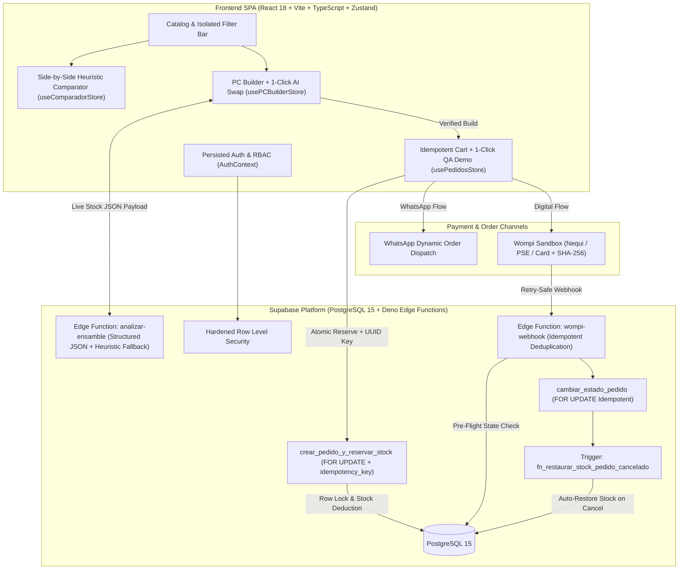

# NEXUS // CORE — High-Performance Hardware Commerce & AI Architecture Platform

> [🇪🇸 Leer documentación en Español](./README.es.md)

**NEXUS // CORE (V2.0 Enterprise)** is a full-stack e-commerce and PC architecture platform engineered with **React 18, TypeScript, Zustand, Supabase PostgreSQL 15, and Deno Edge Functions**. It solves the highest-friction engineering bottlenecks in high-ticket PC hardware retail: physical/power compatibility errors, CPU/GPU architecture bottlenecks, race conditions during concurrent stock reservations, duplicate webhook retries, and non-destructive catalog administration.

---

## 🏗️ System Architecture



---

## ⚙️ Core Engineering Capabilities

### 1. Concurrent PostgreSQL Row-Level Locking (`FOR UPDATE`) & Transactional Idempotency
Traditional client-side stock checks fail under concurrent checkouts and network retries. **NEXUS // CORE** guarantees ACID inventory correctness directly in PostgreSQL:
- **Row-Level Locks (`FOR UPDATE`):** `public.crear_pedido_y_reservar_stock` locks target rows in `public.productos`, verifies `stock >= requested_quantity`, deducts inventory atomically, and inserts the order in a single database transaction—eliminating overselling.
- **Advisory Serialization + `idempotency_key`:** Every checkout attempt sends a client-generated UUID v4 (`idempotency_key uuid UNIQUE` on `public.pedidos`). The RPC acquires `pg_advisory_xact_lock(hashtext(p_idempotency_key::text))` and short-circuits duplicate submissions or double-clicks by returning the existing order without deducting stock twice.
- **Automatic Stock Reversal Trigger (`fn_restaurar_stock_pedido_cancelado`):** When an order transitions from `pendiente` to `cancelado`, a `BEFORE UPDATE OF estado` database trigger automatically restores all reserved item quantities back to `public.productos`.
- **Zero-Downtime Backward Compatibility:** `usePedidosStore` deduplicates in-flight requests per idempotency key and gracefully detects older 5-parameter database schemas if the V2.0 migration has not been applied yet.

### 2. Idempotent Payment Webhooks & Wompi Sandbox Gateway
- **Client-Side SHA-256 Integrity Signing:** Generates Wompi integrity hashes (`SHA256(Reference + AmountInCents + Currency + IntegritySecret)`) natively via the browser Web Crypto API (`generarFirmaIntegridadWompi`).
- **Retry-Tolerant Edge Function (`supabase/functions/wompi-webhook`):**
  - Verifies optional `WOMPI_EVENTS_SECRET` SHA-256 event signatures.
  - Deduplicates rapid in-memory webhook retries via `${transaction.id}:${transaction.status}` tracking.
  - Executes a pre-flight query on `public.pedidos` (`id, estado, referencia_pago`) and locks the row inside `cambiar_estado_pedido` (`FOR UPDATE`), making duplicate webhook deliveries strictly no-op after completion.
- **1-Click Demo Checkout Experience:** Both `CarritoSidebar` and `WompiCheckoutModal` feature a subtle **"Rellenar datos de prueba"** button so reviewers can execute the full end-to-end flow (*Atomic Reservation $\rightarrow$ Wompi Sandbox $\rightarrow$ Webhook/RPC Transition $\rightarrow$ Live Stock Deduction or Reversal*) in under 5 seconds.

### 3. AI Hardware Bottleneck Advisor & Interactive PC Builder (`analizar-ensamble`)
- **Step-by-Step Compatibility Engine (`usePCBuilderStore`):** Enforces socket matching (`AM5`, `AM4`, `LGA1700`, `LGA1200`), memory standard alignment (`DDR4` vs `DDR5`), chassis form factor clearances (`ATX`, `Micro-ATX`, `Mini-ITX`), and real-time wattage headroom calculations ($(\text{TDP} + 40\text{W}) \times 1.25$).
- **Live Inventory AI Architect (`supabase/functions/analizar-ensamble`):**
  - **Structured JSON Outputs:** Evaluates CPU/GPU tier symmetry, PSU transient power headroom, RAM dual-channel configuration, and high-TDP thermal cooling requirements via LLM (`GEMINI_API_KEY` or `OPENAI_API_KEY`).
  - **Zero-Hallucination Stock Guard:** Every `producto_sugerido_id` returned by an LLM is strictly cross-checked against live catalog items with `stock > 0` and verified for socket/RAM compatibility before reaching the UI.
  - **Sub-50ms Deterministic Fallback:** When no LLM API key is configured (or on upstream timeout), the Edge Function and client (`analizarEnsambleDeterministico`) run a deterministic heuristic hardware scoring engine so diagnostics never fail.
  - **1-Click Live Swap:** Displays up to 2 real in-stock catalog upgrades inside the flagship **NEXUS AI // ARCHITECT** card with instant **Swap 1-Click** replacement.

### 4. Collision-Free Heuristic Comparator & Non-Destructive Admin Staging
- **Strict Component Isolation (`useComparadorStore`):** Evaluates motherboards (`Chipset`, form factor, chipset families) and coolers prior to CPUs in `obtenerTipoProducto`, preventing motherboards that mention *"AMD Ryzen"* in descriptions from ever matching CPU comparisons.
- **Automated Spec Winner Highlighting (`obtenerIndicesGanadores`):** Highlights best price, lowest latency/response time, highest VRAM/frequency/refresh rate/wattage side-by-side.
- **Non-Destructive Media Staging (`AdminProductoModal`):** Admins can stage primary or gallery images for deletion (previewed in grayscale) and restore them at will; storage/database mutations only commit on save. Includes hierarchical `Componentes` / `Periféricos` selectors and critical stock quick-restock (`+5` / `+10` units) in `SettingsModal`.
- **Viewport-Isolated Category Filtering (`Home.tsx`):** Styled custom horizontal scrollbar (`.custom-h-scrollbar`), lateral navigation buttons, and non-passive wheel listeners (`data-lenis-prevent="true"`, `overscroll-contain`) isolate category scrolling without moving the vertical page viewport.

---

## 🗄️ Database Schema & Migration Guide (Supabase)

### Applying SQL Migrations
Run the migration files inside your Supabase project's **SQL Editor** in chronological order (or push with `supabase db push`):

1. `supabase/migrations/20240101000000_initial_schema.sql` *(base products, reviews, profiles, RLS)*
2. `supabase/migrations/20261027_security_hardening.sql` *(hardened RLS policies & `is_admin()` guard)*
3. `supabase/migrations/20261028000000_performance_and_rpc.sql` *(indexed queries & catalog RPCs)*
4. `supabase/migrations/20261028010000_orders_and_pc_builder.sql` *(`pedidos` table, `FOR UPDATE` reservation, auto-restore trigger)*
5. **`supabase/migrations/20261115000000_idempotency_and_ai_advisor.sql`** *(adds `idempotency_key uuid UNIQUE`, `pg_advisory_xact_lock`, and idempotent `cambiar_estado_pedido`)*

### Deploying Edge Functions (Optional Cloud Functions)
```bash
# Deploy Edge Functions to Supabase
supabase functions deploy wompi-webhook
supabase functions deploy analizar-ensamble

# Optional LLM & Webhook Secrets
supabase secrets set GEMINI_API_KEY=your_key_here
supabase secrets set WOMPI_EVENTS_SECRET=your_wompi_events_secret
```
> **Note:** Both `analizar-ensamble` and client checkout operate smoothly even without external AI API keys thanks to the built-in deterministic heuristic engine and backward-compatible RPC handlers.

---

## 🚀 Local Setup & Verification

### 1. Environment Variables (`.env`)
```env
VITE_SUPABASE_URL=https://your-project.supabase.co
VITE_SUPABASE_ANON_KEY=your-supabase-anon-key

# Wompi Sandbox Gateway (Defaults included for local QA)
VITE_WOMPI_PUBLIC_KEY=pub_test_NexusCoreSandboxCol
VITE_WOMPI_INTEGRITY_SECRET=test_integrity_nexuscore_sandbox_secret
```

### 2. Run & Verify
```bash
# Install dependencies
npm install

# Start Vite development server
npm run dev

# Strict ESLint check (must exit 0)
npm run lint

# Strict TypeScript compilation (tsc -b) + Vite production bundle
npm run build
```

---

## 🛠️ Tech Stack
- **Frontend:** React 18, TypeScript 5, Vite 8, Tailwind CSS 3, Zustand 5, React Router DOM v6, Lenis Smooth Scroll, Lucide Icons, Sonner
- **Backend / Database:** Supabase PostgreSQL 15, PL/pgSQL Transactional RPCs, Row Level Security (RLS), Deno Edge Functions
- **Payments & AI:** Wompi Colombia Sandbox (Web Crypto SHA-256), Structured JSON Hardware Advisor (Gemini/OpenAI + Deterministic Engine)
